  

  
<strong>Marketing by trade. Tech by obsession.</strong>

  
Stories with signal. Systems with taste.

  

# Ariyana

I work across content, storytelling, and software. This profile is where I share the tools, experiments, and projects I spend time building.

Most of my work starts with a practical problem: an awkward manual process, a game feature I want to explore, or something that would be easier with a small piece of software. I prefer clear documentation and projects that are honest about what works and what is still unfinished.

## Projects

| Project | What you'll find |
| --- | --- |
| [Guest Check-in Automation](https://github.com/ass3mble/guest-checkin-automation) | A Python service for guest check-in, document reading, Telegram review, and optional booking and smart-lock integrations. |
| [DRAX FPS](https://github.com/ass3mble/drax-fps) | A browser-based tactical shooter with multiplayer networking, maps, weapons, and a work-in-progress game engine. |
| [Modern Warfare 4 Vietnamese Localization](https://github.com/ass3mble/modern-warfare-4-vietnamese-pack) | A community Vietnamese translation package with an offline installer and compatibility checks. |
| [WeMod (Wand) Patcher](https://github.com/ass3mble/wemod-wand-pro-patcher) | A Windows executable shared for local Electron application patching and compatibility research. |

## What interests me

- Making everyday work less repetitive with thoughtful automation.
- Building interactive experiences and experimenting with game mechanics.
- Language, localization, and making software easier to use.
- Writing documentation that people can actually follow.

Each project has its own setup instructions, limitations, and license details. Check the repository before downloading or running anything, especially when a project is still being developed.

  

