  

  <h1>Ariyana</h1>
  
Automation, game development, and Vietnamese localization.

  
I like building tools that solve real problems and experimenting with software that is fun to use.

## About me

I work across marketing, content, and software development. Some of my projects help with everyday operations; others come from a curiosity about games, interfaces, and how things work behind the scenes.

I share the code, the decisions behind it, and the parts that still need work. If a project is experimental or not ready to deploy, its repository should say so.

## Featured projects

| Project | What it does | Current scope |
| --- | --- | --- |
| **[Guest Check-in Automation](https://github.com/ass3mble/guest-checkin-automation)** | Helps manage guest information, document extraction, Telegram review, and optional booking or smart-lock integrations. | Active development; security and deployment guidance included |
| **[DRAX FPS](https://github.com/ass3mble/drax-fps)** | A tactical browser shooter built with Three.js, React, TypeScript, and a WebSocket multiplayer server. | Engine refactor in progress; published snapshot is not yet build-ready |
| **[Modern Warfare 4 Vietnamese Localization](https://github.com/ass3mble/modern-warfare-4-vietnamese-pack)** | Community translation work covering campaign dialogue, subtitles, and game text, with an offline installer. | Public V6.157 package; installation compatibility checks included |
| **[WeMod (Wand) Patcher](https://github.com/ass3mble/wemod-wand-pro-patcher)** | A Windows utility shared for local Electron archive and application compatibility research. | Compiled executable; source code is not published in that repository |

## What I focus on

**Automation:** Cutting down repetitive work while keeping people in control of important decisions.

**Games:** Exploring real-time systems, multiplayer networking, combat mechanics, and responsive interfaces.

**Localization:** Making dialogue and interface text feel natural without losing the original meaning or context.

**Documentation:** Clear setup steps, known limitations, and useful examples instead of exaggerated claims.

## Explore the repositories

The repositories above contain their own instructions and licensing information. Start with each project's README before installing anything or using it with real data.

  

